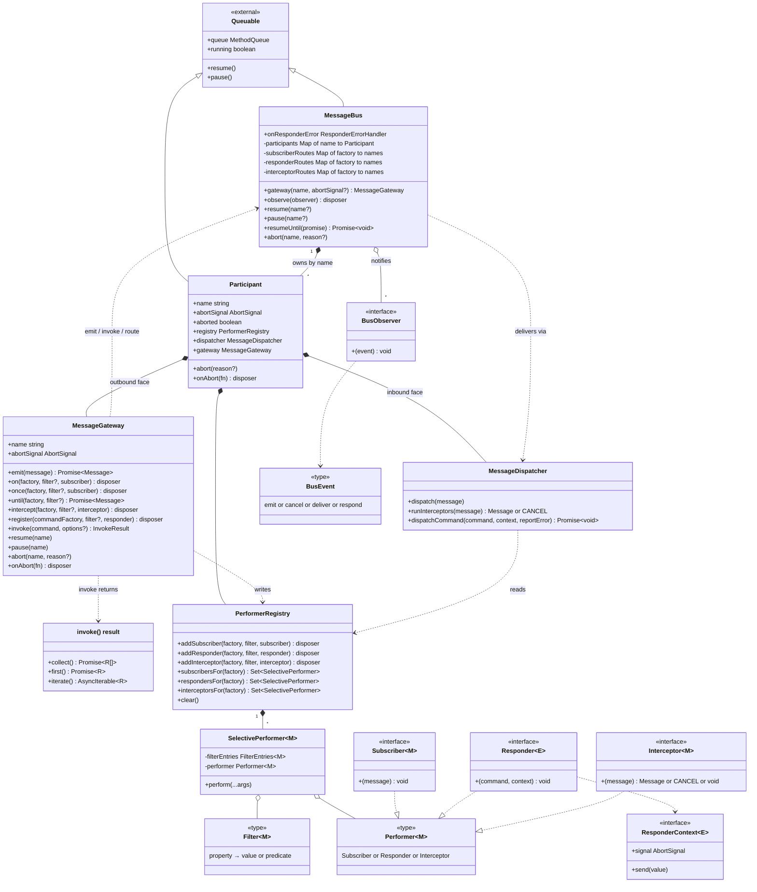
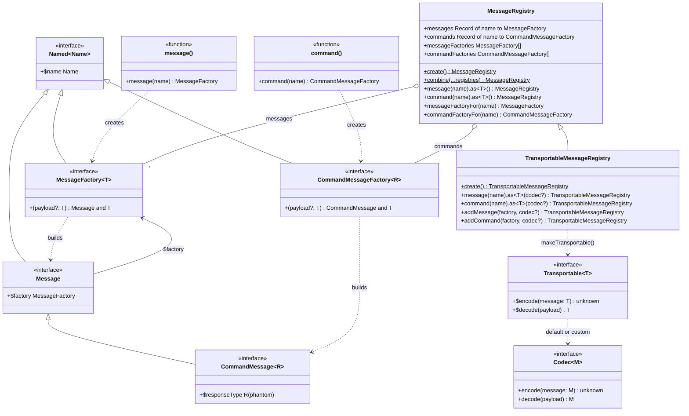
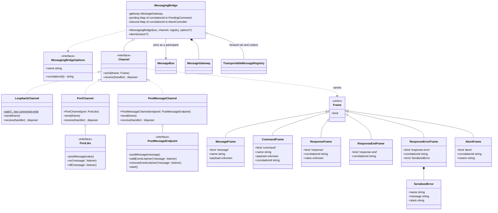

# @plugola/message-bus

A small message bus for plugin systems, modelled on
[Enterprise Integration Patterns](https://www.enterpriseintegrationpatterns.com/).

Each member of the bus is a **participant**, and holds a **gateway**. Through it a
participant publishes and subscribes to **messages** (plain objects built with the
`message()` factory), transforms them in flight with **interceptors**, and uses the
**invoke** pattern to ask other participants for a stream of values. Each
participant owns its own queue, so any participant can be paused and resumed
independently. Two buses in different runtimes (a window, a web worker, a server)
can be joined with a **messaging bridge**.

## Concepts at a glance

- **`MessageBus`** — the hub the host owns. It hands out gateways and controls
  participant lifecycle (`resume` / `pause` / `abort`).
- **`MessageGateway`** — what `bus.gateway(name)` returns; the object a
  participant actually uses to subscribe, emit, and invoke.
- **Message** — a plain object built with the `message()` factory. Routing is by
  _factory_, not by `$name` (which is a label, and the key used on the wire when
  bridging).
- **`CommandMessage`** — defined with `command()`; a message that also collects a
  stream of values back from its responders.

The handler roles line up with EIP: a **Subscriber** receives messages
(`on` / `once` / `until`), a **Responder** streams values back for a command
(`register`), and an **Interceptor** is a Message Translator stage that can
transform or veto a message before subscribers see it (`intercept`).

See [Class diagrams](#class-diagrams) for how these fit together.

## Defining messages

Define a message with `message()` and a command with `command()`. You give a wire
name and a payload type; each returns a **factory** you call (no `new`) with the
payload to build a message — a plain object that _is_ its payload plus a little
metadata.

```typescript
import { message, command } from '@plugola/message-bus'

const Greeting = message<{ text: string }>('greeting')
const ListFiles = command<{ dir: string }, string>('list-files')

const greeting = Greeting({ text: 'hello' })
greeting.text // 'hello'
greeting.$name // 'greeting'
```

Each factory carries its own name (`$name`), which is how the bus routes it and
how it's addressed on the wire — the factory itself is the routing identity, and
every message points back at it via `$factory`. A plain `message()`/`command()`
is all you need to route within a single bus. To send a message _across_ a
[bridge](#transports-bridging-buses) it also needs a codec (`$encode`/`$decode`);
that's added by defining it through a `MessageRegistry`, not by these factories —
see [Transports](#transports-bridging-buses).

## Getting started

```typescript
import { MessageBus, message } from '@plugola/message-bus'

const Greeting = message<{ text: string }>('greeting')

const bus = new MessageBus()
const alice = bus.gateway('alice')
const bob = bus.gateway('bob')

alice.on(Greeting, (greeting) => {
  console.info(`alice heard: ${greeting.text}`)
})

bus.resume()

bob.emit(Greeting({ text: 'hello world' }))
```

Every subscription returns a disposer:

```typescript
const off = alice.on(Greeting, handler)
off() // unsubscribe
```

## Paused until resumed

Participants begin paused, so nothing is delivered until the bus is resumed —
it's safe to wire up subscriptions first. Messages emitted while a participant is
paused are buffered and replayed when it resumes. `bus.resume()` replays nothing
until every participant is running, so a buffered message meets every
participant's interceptors and responders, whichever order they were created in.

```typescript
const bus = new MessageBus()
const gateway = bus.gateway('my-gateway')

gateway.on(Greeting, () => console.info("I'll run once the bus is resumed"))
gateway.emit(Greeting({ text: 'hi' }))

bus.resume()
```

## Payloads

In-process, a message is delivered by reference, so its payload may hold
anything — DOM nodes, callbacks, class instances. Bear in mind that a subscriber
on a paused participant receives the message later, by which time a referenced
object may have changed.

Messages that cross a bridge are different: see
[Transports](#transports-bridging-buses). A message registered on a
`TransportableMessageRegistry` with the default codec must have a JSON-safe
payload (strings, numbers, booleans, `null`, and arrays/plain objects of those).
This is a **compile-time** rule; keys prefixed with `$` (framework metadata like
`$name`) are exempt. A payload that isn't JSON-safe needs a full custom codec.

```typescript
TransportableMessageRegistry.create()
  .message('clicked')
  .as<{ el: HTMLElement }>() // ⛔ HTMLElement isn't serializable
```

## Filtering subscriptions

Pass a filter to narrow a subscription to the messages you care about. A filter
is a partial map of the message's properties; each value is either an expected
value (compared with `===`) or a predicate. **All** listed keys must match.

```typescript
const Order = message<{ status: 'pending' | 'paid'; total: number }>('order')

gateway.on(Order, { status: 'paid', total: (o) => o.total > 100 }, (order) => {
  console.info('big paid order', order)
})

gateway.emit(Order({ status: 'pending', total: 500 })) // ignored — status
gateway.emit(Order({ status: 'paid', total: 50 })) // ignored — total
gateway.emit(Order({ status: 'paid', total: 500 })) // delivered
```

Filters work with `on`, `once`, `until`, `register`, and `intercept`.

## Waiting for a message

`until` resolves with the next matching message, and rejects if the participant
is aborted while waiting.

```typescript
const order = await gateway.until(Order, { status: 'paid' })
```

## Interception

Interceptors run before subscribers and can transform or cancel a message. Return
a new message to replace it, `CANCEL` to drop it, or nothing to leave it
unchanged. Interceptors across participants form a chain, each seeing the
previous one's result.

```typescript
gateway.intercept(Greeting, (greeting) =>
  Greeting({ text: greeting.text.toUpperCase() }),
)

gateway.on(Greeting, (g) => console.info(g.text)) // "HELLO"

await gateway.emit(Greeting({ text: 'hello' }))
```

Cancelling stops the message completely:

```typescript
import { CANCEL } from '@plugola/message-bus'

gateway.intercept(Greeting, () => CANCEL)

const result = await gateway.emit(Greeting({ text: 'hello' }))
// result === CANCEL, and no subscribers were called
```

## Commands (request / stream)

A command is a message whose registered responders stream values back. Any number
of participants can register for the same command; the caller collects the values
from all of them (a scatter-gather).

```typescript
import { MessageBus, command } from '@plugola/message-bus'

const ListFiles = command<{ dir: string }, string>('list-files')

const bus = new MessageBus()
const fs = bus.gateway('fs')
const app = bus.gateway('app')
bus.resume()

fs.register(ListFiles, async (cmd, { send, signal }) => {
  for (const file of await readdir(cmd.dir, { signal })) send(file)
})

// collect everything into an array…
const files = await app.invoke(ListFiles({ dir: '/tmp' })).collect()

// …or consume as a stream
for await (const file of app.invoke(ListFiles({ dir: '/tmp' })).iterate()) {
  console.info(file)
}
```

A responder is done when its function returns (or its returned promise settles) —
there is no `finish()` to call. The command completes once every responder across
every participant has settled.

Because a command is emitted as a message before it is invoked, it can also be
filtered and intercepted like any other message.

### Cancelling and errors

Pass a `signal` to cancel; it is forwarded to responders so they can abort
in-flight work. By default an unobserved responder error is fail-loud — it
rejects the stream. Pass `onError` to isolate responders instead: errors are
reported there and the stream still completes with the healthy responders'
values.

```typescript
const files = await app
  .invoke(ListFiles({ dir: '/tmp' }), {
    signal: AbortSignal.timeout(1_000),
    onError: (error) => console.warn('a file source failed', error),
  })
  .collect()
```

To isolate responders on every invoke that doesn't pass its own `onError`,
give the bus an `onResponderError`:

```typescript
const bus = new MessageBus({
  onResponderError: (error) => console.error(error),
})
```

## Observing the bus

`bus.observe` sees every message as it is emitted (with the sender's name),
cancelled by an interceptor, delivered to a participant's subscribers, or handed
to a participant's responders. Useful for tracing and for asserting on traffic
in tests; an observer can't change what happens.

```typescript
const stop = bus.observe((event) => {
  if (event.type === 'emit') console.log(event.from, '→', event.message.$name)
})
```

## Pausing and lifecycle

Each participant has its own queue, so participants pause independently.
Lifecycle methods address participants by name, so one participant can control
another's.

```typescript
gateway.pause('worker') // buffer the worker's messages
gateway.resume('worker') // resume and drain them

gateway.abort('worker') // permanent teardown; frees the name for reuse
```

The host can also drive every participant at once through the bus:

```typescript
bus.pause() // pause all
bus.resume() // resume all
```

### Externally abortable participants

Pass an `AbortSignal` when creating a gateway to tie its lifetime to something
you already own — a plugin's own lifecycle, a request scope, a test's teardown.
Aborting that signal tears the participant down just like `abort(name)`.

```typescript
const controller = new AbortController()
const plugin = bus.gateway('plugin', controller.signal)

controller.abort() // clears the plugin's handlers and frees its name
```

A gateway exposes its abort state for cleanup via the underlying signal:

```typescript
gateway.onAbort((reason) => cleanup(reason))
gateway.abortSignal.aborted // boolean
gateway.abortSignal.reason // the reason, if any
```

## Transports (bridging buses)

Two buses in separate runtimes — a window and a web worker, a client and a
server — can be joined with a **`MessagingBridge`** (EIP's _Messaging Bridge_).
The bridge joins each bus as a participant and replicates messages and commands
across a **`Channel`**, so neither bus core needs to know a transport exists.

A **`TransportableMessageRegistry`** is the contract the two ends share: it maps each `$name`
to its factory, so a message named on the wire can be resolved and decoded on the
other side. Defining a message _through_ the registry registers it in one act —
so it can't be forgotten — and the registry doubles as the set of factories the
bridge relays.

```typescript
// contract.ts — imported by both ends
import { TransportableMessageRegistry } from '@plugola/message-bus'

export const registry = TransportableMessageRegistry.create()
  .message('ping')
  .as<{ at: number }>()
  .command('sum')
  .as<{ a: number; b: number }, number>()

export const { ping: Ping } = registry.messages
export const { sum: Sum } = registry.commands
```

A factory already defined with `message()` or `command()`, in a module the rest
of the app imports, can be added as it is. The same factory then routes locally
and crosses the bridge:

```typescript
import { UserActive, GetSettings } from './messages.ts'

export const registry = TransportableMessageRegistry.create()
  .addMessage(UserActive)
  .addCommand(GetSettings)
```

Registering is also what gives a factory its codec (`$encode`/`$decode`) — the
serialisation the bridge uses. By default a message encodes to its own fields and
decodes by reconstruction, so most messages need nothing extra. Pass a codec only
for non-trivial wire shapes:

```typescript
const registry = TransportableMessageRegistry.create()
  .message('occurred')
  .as<{ at: Date }>({
    encode: (m) => ({ at: m.at.toISOString() }),
    decode: (p) => registry.messages.occurred({ at: new Date(p.at) }),
  })
```

Wire a bridge onto each bus over a channel. `LoopbackChannel.pair()` is an
in-memory channel handy for tests and same-process bridging.
`PostMessageChannel` works over a browser `Worker`, a worker's `self` or a
`MessagePort`, and `PortChannel` over a `node:worker_threads` port. For other
transports you implement `Channel` (two methods) over a `WebSocket`, etc.

```typescript
// page
new MessagingBridge(bus, new PostMessageChannel(new Worker(url)), registry)
// worker
new MessagingBridge(bus, new PostMessageChannel(self), registry)
```

```typescript
import {
  MessageBus,
  MessagingBridge,
  LoopbackChannel,
} from '@plugola/message-bus'
import { registry, Sum } from './contract.ts'

const [here, there] = LoopbackChannel.pair()

new MessagingBridge(busA, here, registry)
new MessagingBridge(busB, there, registry)

// A responder on busB…
busB.gateway('math').register(Sum, (cmd, { send }) => send(cmd.a + cmd.b))

// …answers an invoke on busA, across the bridge.
const [sum] = await busA
  .gateway('app')
  .invoke(Sum({ a: 2, b: 3 }))
  .collect()
// sum === 5
```

The bridge handles the awkward parts: only registered factories cross; a message
received from the wire is never relayed back (no echoes); commands are correlated
so responses stream to the right caller; cancelling an `invoke` aborts the remote
responder; and errors cross as a plain envelope.

### Implementing a `Channel`

A channel is a duplex pipe of frames. Each frame is already JSON-safe, so an
adapter serialises however its transport needs.

```typescript
import type { Channel, Frame } from '@plugola/message-bus'

class WebSocketChannel implements Channel {
  constructor(private readonly socket: WebSocket) {}

  send(frame: Frame) {
    this.socket.send(JSON.stringify(frame))
  }

  receive(handler: (frame: Frame) => void) {
    const listener = (e: MessageEvent) => handler(JSON.parse(e.data))
    this.socket.addEventListener('message', listener)
    return () => this.socket.removeEventListener('message', listener)
  }
}
```

Both ends build an equivalent registry from the shared contract module; the
factories are distinct objects per runtime (identity routes locally, `$name`s
cross the wire).

## Class diagrams

How the pieces fit together. Members are abridged to the public surface (plus
the private state that explains the wiring), and generics are trimmed for
readability. Function-shaped interfaces (a subscriber, a factory, …) show their
call signature as `+(args)`.

### Bus, participants and handlers

The bus owns one `Participant` per name. A participant is a queued kernel with
two faces: the `MessageGateway` the application holds (outbound — it writes the
`PerformerRegistry` and publishes onto the bus) and the `MessageDispatcher` the
bus drives (inbound — it reads the registry and runs the handlers).



`Queuable` comes from [`@plugola/queue`](../queue).

### Messages, factories and registries

Messages are plain objects; their factory is the routing identity. A
`MessageRegistry` adds name-uniqueness and a `$name` → factory lookup; a
`TransportableMessageRegistry` also layers a codec onto each factory so it can
cross a bridge.



### Transports

A `MessagingBridge` joins a bus as an ordinary participant and relays every
factory in its `TransportableMessageRegistry` over a `Channel` as `Frame`s.


